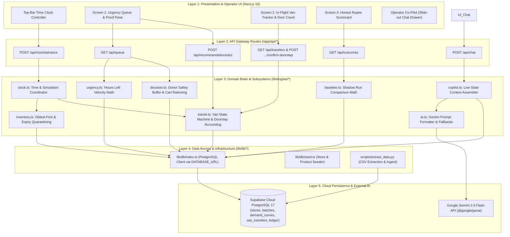
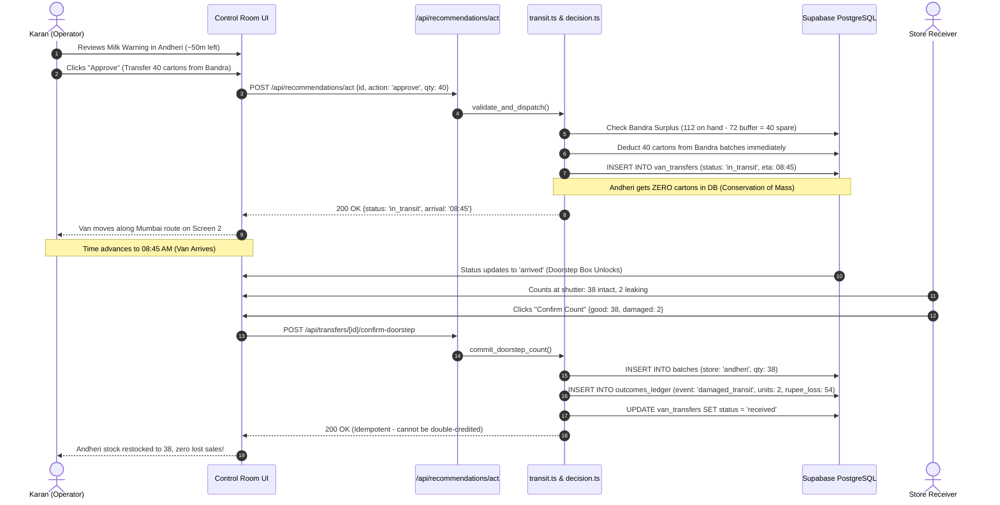
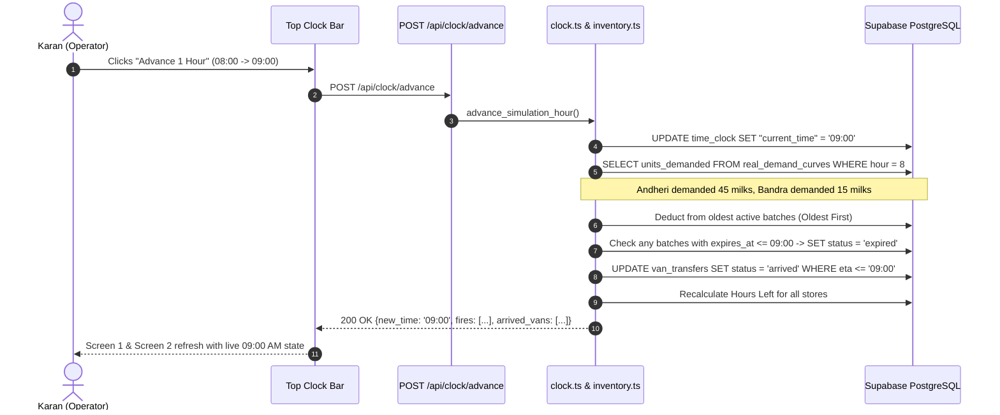
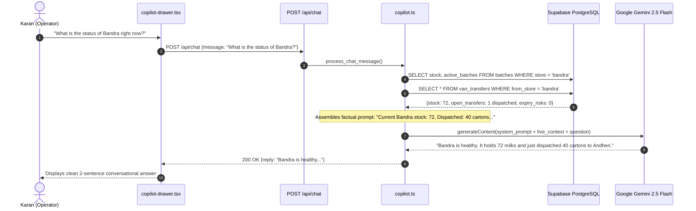
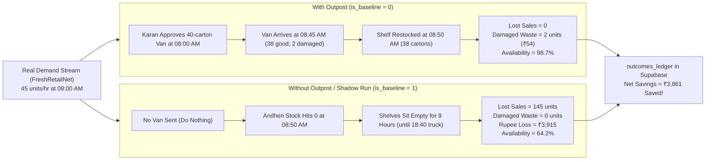

# ARCHITECTURE.md — Technical Blueprint

Outpost V1 is a single-operator inventory control engine for 3 Mumbai quick-commerce dark stores. It is built as a unified Next.js 16 application connected directly to a hosted Supabase PostgreSQL (Postgres 17) database, with zero mock data.

---

## 1. System Overview & Visual Diagrams

### A. The 5-Layer System Architecture
This diagram shows how every layer connects: from your browser screen down to Supabase and Gemini.



---

### B. Flow 1: The Van Transfer & Doorstep Confirmation Lifecycle
How a carton of Amul Milk moves from approval to doorstep counting without phantom inventory.



---

### C. Flow 2: Advancing the Clock 1 Hour & Sales Consumption
What happens when you click "Advance 1 Hour" to step time forward deterministically.



---

### D. Flow 3: The Operator Co-Pilot Chatbot Flow
How the natural language assistant queries live database state and generates factual answers.



---

### E. Flow 4: The Shadow Run Comparison (With vs Without Outpost)
How Outpost calculates honest rupee savings side-by-side using the identical demand stream.



---

## 2. Directory Layout

```
D:\Outpost V1\
├── app/
│   ├── api/
│   │   ├── clock/
│   │   │   ├── route.ts                 # GET current time
│   │   │   └── advance/route.ts         # POST advance clock 1 hr (triggers sales & transit)
│   │   ├── queue/route.ts               # GET prioritized fires ranked by Hours Left
│   │   ├── recommendations/
│   │   │   └── act/route.ts             # POST approve/reject transfer or price cut
│   │   ├── transfers/
│   │   │   ├── route.ts                 # GET active and delivered van transfers
│   │   │   └── [id]/
│   │   │       └── confirm-doorstep/route.ts  # POST physical count at dark store door
│   │   ├── chat/route.ts                # POST natural language question to Co-Pilot
│   │   ├── ingest/
│   │   │   ├── route.ts                 # POST upload custom dark store CSV
│   │   │   └── reset/route.ts           # POST reset to default Mumbai benchmark data
│   │   └── outcomes/route.ts            # GET "With Outpost" vs "Without Outpost" ledger
│   ├── layout.tsx                       # Root layout with top bar clock controller
│   └── page.tsx                         # Single-screen command center (Queue / In-Flight / Outcomes)
├── components/
│   ├── top-clock-bar.tsx                # Time clock display and "Advance 1 Hour" button
│   ├── queue-screen.tsx                 # Screen 1: Prioritized risk cards & proof pane
│   ├── inflight-screen.tsx              # Screen 2: Active vans & doorstep count modal
│   ├── outcomes-screen.tsx              # Screen 3: Rupee loss & baseline scorecard
│   ├── copilot-drawer.tsx               # Collapsible slide-out operator chat assistant
│   ├── csv-upload-modal.tsx             # Modal to upload and validate custom dark store CSV
│   └── ui/                              # Buttons, badges, cards, inputs (shadcn-compatible)
├── lib/
│   ├── db/
│   │   ├── index.ts                     # Supabase PostgreSQL client (via DATABASE_URL)
│   │   ├── schema.sql                   # SQL table definitions for PostgreSQL 17
│   │   └── seed.ts                      # Database seeder (stores, products, starting batches)
│   ├── engine/
│   │   ├── clock.ts                     # Clock advancement & simulation coordinator
│   │   ├── inventory.ts                 # Oldest-First deduction, expiry locking
│   │   ├── urgency.ts                   # Hours Left calculation from demand curves
│   │   ├── decision.ts                  # Van transfer validation & safety cushion check
│   │   ├── transit.ts                   # In-flight van state machine & doorstep accounting
│   │   ├── baseline.ts                  # Shadow Run computation ("Without Outpost")
│   │   ├── copilot.ts                   # Live DB context retrieval & Gemini chat handler
│   │   ├── ingest.ts                    # CSV parser, validator, and Supabase loader
│   │   └── ai.ts                        # Gemini explanation caller with offline fallback
│   └── types.ts                         # Shared TypeScript interfaces
├── data/
│   └── mumbai_anchor_demand.csv         # 255 verified hourly demand curves for Andheri West, Bandra, Powai
├── scripts/
│   └── extract_data.py                  # Extractor script generating clean CSVs from dataset
├── docs/
│   └── adr/                             # Architectural Decision Records (0001 to 0009)
├── GLOSSARY.md                          # Plain-English domain dictionary
├── PRD.md                               # Product Requirements Document
├── ARCHITECTURE.md                      # This document
├── TASKS.md                             # Atomic verification task checklist
├── JOURNAL.md                           # Progress and proof log
└── verify.ps1                           # Automated typecheck, test, and build runner
```

---

## 3. Database Schema (Supabase PostgreSQL 17)

All tables live in the `public` schema on Supabase Cloud PostgreSQL. Zero local mock data.

```sql
-- 1. Dark Stores
CREATE TABLE stores (
    id TEXT PRIMARY KEY,                 -- 'andheri-west', 'bandra', 'powai'
    name TEXT NOT NULL,                  -- 'Andheri West', 'Bandra', 'Powai'
    city TEXT NOT NULL DEFAULT 'Mumbai',
    safety_cushion_pct NUMERIC(4,2) DEFAULT 0.20 -- 20% safety cushion over projected demand
);

-- 2. Mumbai Route Travel Times (in minutes)
CREATE TABLE store_routes (
    from_store_id TEXT REFERENCES stores(id) ON DELETE CASCADE,
    to_store_id TEXT REFERENCES stores(id) ON DELETE CASCADE,
    travel_minutes INTEGER NOT NULL,     -- Bandra->Andheri: 45, Bandra->Powai: 60, Andheri->Powai: 40
    PRIMARY KEY (from_store_id, to_store_id)
);

-- 3. Core Products (The 5 Anchor Staples)
CREATE TABLE products (
    id TEXT PRIMARY KEY,                 -- 'amul-taaza-500', 'mother-dairy-dahi-400', etc.
    name TEXT NOT NULL,                  -- 'Amul Taaza Milk 500ml'
    category TEXT NOT NULL,              -- 'dairy', 'bakery', 'breakfast'
    unit_mrp NUMERIC(10,2) NOT NULL,     -- 27.00, 35.00, 45.00, etc.
    shelf_life_days INTEGER NOT NULL
);

-- 4. Inventory Batches (Batches as Absolute Truth)
CREATE TABLE batches (
    id UUID PRIMARY KEY DEFAULT gen_random_uuid(),
    store_id TEXT REFERENCES stores(id) ON DELETE CASCADE,
    product_id TEXT REFERENCES products(id) ON DELETE CASCADE,
    batch_code TEXT NOT NULL,            -- e.g. 'BAT-AMUL-20261025-01'
    initial_qty INTEGER NOT NULL,
    current_qty INTEGER NOT NULL,
    expires_at TIMESTAMPTZ NOT NULL,     -- Strict expiration timestamp
    status TEXT NOT NULL DEFAULT 'active'-- 'active', 'expired', 'depleted'
);

-- 5. Real Hourly Demand Curves (Extracted from FreshRetailNet-50K)
CREATE TABLE real_demand_curves (
    id BIGINT GENERATED ALWAYS AS IDENTITY PRIMARY KEY,
    store_id TEXT REFERENCES stores(id) ON DELETE CASCADE,
    product_id TEXT REFERENCES products(id) ON DELETE CASCADE,
    hour_of_day INTEGER NOT NULL,        -- 6 to 22 (06:00 to 22:00)
    units_demanded NUMERIC(6,2) NOT NULL,-- Real hourly sales rate from dataset
    source_dataset TEXT DEFAULT 'FreshRetailNet-50K'
);

-- 6. Van Transfers (In-Flight State Machine)
CREATE TABLE van_transfers (
    id UUID PRIMARY KEY DEFAULT gen_random_uuid(),
    from_store_id TEXT REFERENCES stores(id) ON DELETE CASCADE,
    to_store_id TEXT REFERENCES stores(id) ON DELETE CASCADE,
    product_id TEXT REFERENCES products(id) ON DELETE CASCADE,
    dispatched_qty INTEGER NOT NULL,
    received_qty INTEGER DEFAULT 0,
    damaged_qty INTEGER DEFAULT 0,
    status TEXT NOT NULL DEFAULT 'approved', -- 'approved', 'dispatched', 'in_transit', 'arrived', 'received'
    dispatched_at TIMESTAMPTZ,
    expected_arrival_at TIMESTAMPTZ,
    received_at TIMESTAMPTZ,
    created_at TIMESTAMPTZ DEFAULT NOW()
);

-- 7. Operational Time Clock
CREATE TABLE time_clock (
    id INTEGER PRIMARY KEY CHECK (id = 1),
    "current_time" TEXT NOT NULL,          -- e.g. '08:00'
    day_date TEXT NOT NULL,              -- e.g. '2026-10-25'
    total_hours_advanced INTEGER DEFAULT 0
);

-- 8. Honest Outcomes Ledger (Tracking Every Rupee and Unit)
CREATE TABLE outcomes_ledger (
    id BIGINT GENERATED ALWAYS AS IDENTITY PRIMARY KEY,
    clock_time TEXT NOT NULL,
    store_id TEXT REFERENCES stores(id) ON DELETE CASCADE,
    product_id TEXT REFERENCES products(id) ON DELETE CASCADE,
    event_type TEXT NOT NULL,            -- 'sale', 'lost_sale', 'damaged_transit', 'expired_waste', 'markdown_sale'
    units INTEGER NOT NULL,
    unit_price NUMERIC(10,2) NOT NULL,
    rupee_impact NUMERIC(10,2) NOT NULL, -- Positive for revenue, negative for waste/lost sales
    is_baseline INTEGER NOT NULL DEFAULT 0 -- 0 = With Outpost, 1 = Without Outpost (Shadow Run)
);
```

---

## 4. Core Subsystems & Logic

### Subsystem A: Urgency & "Hours Left" Engine
* **Input:** Current on-hand stock (sum of active batches) and hourly sales rate from `real_demand_curves`.
* **Calculation:** `Hours Left = on_hand_stock / hourly_sales_rate`.
* **Sort Order:** Main queue sorted ascending by `Hours Left`. Items with `< 1.5 hours` get flagged with red alerts.

### Subsystem B: Decision & Donor Safety Engine
* **Surplus Check:** `Bandra Surplus = Current Stock - (Projected Demand until 18:40 PM warehouse truck * 1.20)`.
* If `Surplus >= Recommended Transfer Quantity`, transfer is approved.
* If `Surplus < Recommended Quantity`, transfer is blocked or scaled down.
* If no store has surplus, system switches recommendation to **Cart Rationing** (max 1–2 cartons per customer) to stretch existing stock.

### Subsystem C: In-Flight Van State Machine
* **Dispatch:** Deducts 40 units from Bandra immediately. Andheri gets **0 units**.
* **Transit:** Tracks van travel time based on `store_routes` (Bandra to Andheri = 45 mins).
* **Doorstep Count:** When van reaches Andheri, count modal unlocks. The receiver inputs actual good units (e.g. 38).
* **Accounting:** 38 units credited to Andheri stock. 2 units logged directly to `damaged_transit` in `outcomes_ledger`.
* **Idempotency:** Updating count checks if `status == 'received'`; duplicate calls return cached result without double-adding stock.

### Subsystem D: Oldest-First & Expiry Engine
* Customer sales always deduct from the batch with the earliest `expires_at`.
* When the clock reaches a batch's `expires_at`:
  * Remaining units in that batch immediately update to `status = 'expired'`.
  * Deducted from available stock.
  * Logged to `outcomes_ledger` as `expired_waste`.

### Subsystem E: Time Clock Controller ("Advance 1 Hour")
When the user clicks "Advance 1 Hour":
1. Increments `time_clock` by 60 minutes.
2. For each store and product, queries `real_demand_curves` for that hour.
3. Consumes demand from active batches using Oldest-First. If stock hits 0, unfulfilled demand logs to `lost_sale`.
4. Advances vans on the road: if transit time elapsed, moves status to `arrived` (awaiting count).
5. Recalculates `Hours Left` across all stores.

### Subsystem F: Shadow Run ("Without Outpost" Baseline)
* Runs in parallel with the exact same demand stream.
* Assumes no van transfer was made and no price cut was applied.
* Records the exact minute Andheri ran empty (08:50 AM) and counts all unfulfilled customer orders between 08:50 AM and the 18:40 PM warehouse arrival.
* Subtracts the Outpost day from the Baseline day to produce honest rupee savings.

### Subsystem G: Outpost Co-Pilot Engine (Live Grounding + Gemini)
* **Input:** Natural language question from the operator (e.g., *"What is Bandra's status?"*).
* **Context Assembly:** Queries Supabase in real time to assemble a concise factual state:
  - Total on-hand stock and active batches per store.
  - Active vans in transit and expected arrival times.
  - Expiry warnings within the next 24 hours.
* **LLM Call:** Sends the factual state + question to Gemini (`@google/genai`) using a strict 2-3 sentence system prompt.
* **Fallback:** Returns pre-computed factual answers if offline or if the API key is not present.
* **Security:** Advisory only. Does NOT execute transfers or mutate database rows.

### Subsystem H: Custom CSV Data Ingestion Engine
* **Input:** User-uploaded CSV file via `/api/ingest/csv` (`multipart/form-data`).
* **Validation:** Validates 6 required columns (`store_name`, `product_name`, `current_stock`, `hourly_sales_rate`, `unit_mrp`, `expiry_hours`). Rejects corrupt or invalid headers with clear error messages.
* **Database Ingestion:** 
  1. Truncates temporary custom tables in Supabase.
  2. Inserts custom stores into `stores`.
  3. Inserts custom products into `products`.
  4. Seeds initial active batches into `batches`.
  5. Populates `real_demand_curves` from the custom hourly sales rates.
* **Result:** The entire dashboard immediately re-renders around the uploaded stores, showing real stockouts and recommendations calculated live for the user's dataset.
* **Reset:** `POST /api/ingest/reset` restores default Mumbai benchmark tables with one click.

---

## 5. API Contracts

| Method | Endpoint | Description |
|---|---|---|
| `GET` | `/api/clock` | Returns current simulation time (`08:00 AM`). |
| `POST` | `/api/clock/advance` | Advances clock by 1 hour; executes demand and transit logic. |
| `GET` | `/api/queue` | Returns cards sorted by Hours Left, proof pane details, and Gemini reasoning. |
| `POST` | `/api/recommendations/act` | `{ id, action: 'approve' | 'reject', qty?: number }` — executes intervention. |
| `GET` | `/api/transfers` | Returns active vans, transit progress, and past deliveries. |
| `POST` | `/api/transfers/[id]/confirm-doorstep` | `{ good_units: 38, damaged_units: 2 }` — commits count to stock and ledger. |
| `POST` | `/api/chat` | `{ message: string }` — returns Gemini Co-Pilot response grounded in live DB state. |
| `POST` | `/api/ingest/csv` | Upload custom CSV file; parses and reloads Supabase tables for custom stores. |
| `POST` | `/api/ingest/reset` | Resets Supabase tables back to the default Mumbai benchmark dataset. |
| `GET` | `/api/outcomes` | Returns scorecard: Lost Sales, Damaged Stock, Rupee Loss, Availability % (With vs Without Outpost). |

---

## 6. Real Data Extraction Strategy

* **Source Data:** FreshRetailNet-50K dark store dataset extracted via `scripts/extract_data.py`.
* **Output Files:** 
  - `data/mumbai_anchor_demand.csv`: 255 verified hourly demand rows for Andheri West, Bandra, and Powai across 5 anchor products from 06:00 to 22:00.
* **Seeder:** `lib/db/seed.ts` loads `data/mumbai_anchor_demand.csv` directly into Supabase PostgreSQL (`real_demand_curves`, `stores`, `products`).
* **Why:** Keeps the runtime web app 100% independent of heavy binary parquet files, booting instantly and running with zero latency.

---

## 7. Verification Invariant

The architecture is strictly tied to `.\verify.ps1`.
Every change must satisfy:
1. `npx tsc --noEmit` exits 0 (zero type errors).
2. `npm test -- --run` exits 0 (all unit & domain tests pass).
3. `npm run build` exits 0 (production Next.js build clean).
